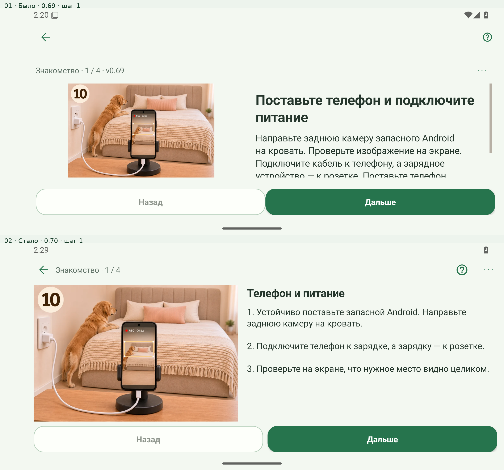

# Обучение 0.70 — фактическая проверка Android

Pixel6 API35 **эмулятор**, не физический телефон. Прогон44976139001, артефакт14735484282.

Все4шага проверены после холодного запуска сразу горизонтально, после поворота каждого шага и при шрифте150%:12случаев,24PNG. Фотография закреплена во всех12случаях, кнопки видны. Высота основной области649px вместо480px(+35,2%). На обычном шрифте пункты помещаются; на крупном текст справа прокручивается до последней строки.

01 — было0.69,02 — стало0.70. Сравнения добавляют подписи снаружи исходных снимков.

[Все измерения](tutorial-proof.json) · [Архив снимков](tutorial-evidence-0.70.zip)
